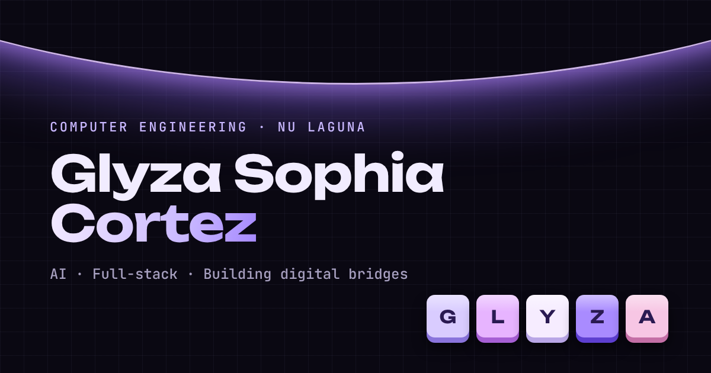

# Glyza Cortez · Portfolio

Personal portfolio of **Glyza Sophia D. Cortez**, a 4th-year Computer Engineering student at National University – Laguna, building with full-stack engineering, AI and computer vision.

🔗 **Live site:** https://glyzacortez.netlify.app



## Features

- **3D keypad navigation.** An interactive G·L·Y·Z·A keypad built with three.js. Hover a key to preview a section, click to jump to it, or press the letters on your keyboard.
- **Satyr, the assistant.** An animated pixel-art helper in the top bar who blinks, greets visitors and answers common questions about me from answers I wrote.
- **Project hover previews.** Short clips of GSC and LUMEN play when you hover a project card, or when it scrolls into view on phones.
- **Journey timeline.** A scroll-animated timeline from my first year to my capstone.
- **Light and dark mode.** Dark by default; each visitor's choice is remembered.
- **Boot screen, signal-trace cursor and starfield background** with circuit traces.
- **Certificates** grouped by issuer, each viewable full size.
- **Contact form** powered by Netlify Forms.
- **Responsive and accessible.** Works from 320 px phones to large monitors, supports keyboard navigation, and respects reduced-motion settings.
- **Fast.** Images and clips load only when needed, and the 3D library loads after the page appears.

## Projects featured

| Project | What it is |
|---|---|
| **EVHUB** | Capstone thesis: a solar-powered charging station for e-trikes and e-quads. I built the software, which runs on a Raspberry Pi. |
| **GSC** | A budget planner for a day, week or month: list what you need to buy and see what's left to spend each day. [Live](https://yusuanc.netlify.app/) |
| **LUMEN** | An achievement jar where every win you log becomes a star. [Live](https://luuumen.netlify.app/) |

## Built with

HTML, CSS and vanilla JavaScript · [three.js](https://threejs.org/) (3D keypad) · Canvas API (background and cursor effects) · Netlify (hosting and forms)

No framework or build step: the whole site is one `index.html` plus an `assets` folder.

## Project structure

```
index.html      the whole site (markup, styles and scripts)
assets/         photos, certificate images, preview clips, Satyr sprites
resume.pdf      downloadable resume
og.png          link-preview image for social media
_headers        Netlify caching rules
```

## Run locally

Open `index.html` in a browser, or serve the folder:

```bash
npx serve .
```

The contact form only sends messages once the site is deployed on Netlify.

## Deploy

Drag the folder (or a zip of it) onto [Netlify Drop](https://app.netlify.com/drop), or connect this repository in Netlify. Then turn on **Forms → Form detection** so contact messages arrive.

## Contact

- Email: glyzacortez27@gmail.com
- LinkedIn: [linkedin.com/in/glyzacortez](https://www.linkedin.com/in/glyzacortez)
- GitHub: [github.com/glyza-za](https://github.com/glyza-za)

---

© 2026 Glyza Sophia D. Cortez
